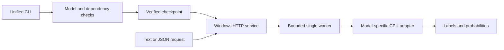

# Project Onboarding: Windows CPU Adaptation

## Two-Minute Overview

vLLM Jev turns a state, questions and candidate answers into structured decisions.
The main project serves Linux through vLLM and selected Apple Silicon models
through MLX or PyTorch MPS. This handoff covers the **24-checkpoint native Windows
CPU adaptation**, whose released-weight acceptance was completed on 2026-10-16
in `vllm-jev-wzh`. It does not close the wider project's development or announce
a package release.

On Windows, the same `vllm-jev serve` command selects a pinned CPU adapter and
exposes `/v1/systemone`. Use the dependency environment and exact weight format
for that model. The [user guide](guide.md#windows-cpu-experimental) is the
operational source of truth; the [retrospective](project-retrospective.md)
records decisions, evidence and remaining risks.

## Target Users and Core Workflow

Application developers send text or JSON state and Choice, Noul or Score
questions to the local HTTP service. Maintainers prepare verified source data,
develop a model-specific scoring adapter, and compare its full probabilities
with an independent reference before changing the accepted-model list.

The normal workflow is: choose a supported model, create its isolated Python
environment, prepare the pinned checkpoint, start the service, inspect
`/health`, then submit decisions. Use one loaded model at a time on a
memory-constrained development computer.

### Validated Model Scope

All rows below passed released-weight Windows CPU inference. The **Original
catalogue** column refers to the 26-model catalogue reviewed at the start of
this adaptation: 15 of those models are covered, plus 9 additional releases.
It is a scope reconciliation, not a claim that all upstream platforms were
retested. The release names and quantizations are part of the acceptance scope.

| Model ID | Windows profile / weight format | Original catalogue | Procedure |
|---|---|---|---|
| `convaiinnovations/laya` | legacy, FP32 | Yes | [Laya](guide.md#check-a-windows-installation) |
| `convaiinnovations/laya-multilingual` | legacy, FP32 | Yes | [Laya](guide.md#check-a-windows-installation) |
| `convaiinnovations/laya-typed-decisions` | legacy, FP32 | Yes | [Laya](guide.md#check-a-windows-installation) |
| `lostargon/Tiny-Jev` | legacy, FP32 | Yes | [Tiny 0.6B](guide.md#validate-tiny-jev-on-windows) |
| `lostargon/Tiny-Jev-1.7B` | legacy, FP32 | No | [Tiny 1.7B](windows-tiny17-jev9.md) |
| `IamBusy/OpenJev-0.6B` | legacy, FP32 | Yes | [OpenJev 0.6B](guide.md#validate-openjev-06b-on-windows) |
| `ZefanCai/Open-Jev-2B` | legacy, BF16 backbone / FP32 head | Yes | [Open-Jev 2B](guide.md#validate-open-jev-2b-on-windows) |
| `Mapika/decider-0.8b` | legacy, BF16 | Yes | [Decider](guide.md#validate-decider-on-windows) |
| `Mapika/decider-2b` | legacy, BF16 | Yes | [Decider](guide.md#validate-decider-on-windows) |
| `alibiserikbay/JevK5-2B` | modern, BF16 | Yes | [JevK5 2B](guide.md#validate-jevk5-kev-and-this-that-on-windows) |
| `alibiserikbay/JevK5-Lite` | modern, FP32 | No | [JevK5 Lite](guide.md#validate-jevk5-lite-on-windows) |
| `alibiserikbay/JevK5` | modern, official Q5_K_M 4B | Yes | [JevK5 4B](guide.md#validate-jevk5-4b-q5_k_m-on-windows) |
| `alibiserikbay/JevK5-9B` | modern, official Q5_K_M | No | [JevK5 9B](windows-tiny17-jev9.md) |
| `jaredpalmer/kev-0.6b` | modern, FP32 | No | [Kev 0.6B](guide.md#validate-kev-06b-on-windows) |
| `jaredpalmer/kev-0.8b` | modern, FP32 | Yes | [Kev 0.8B](guide.md#validate-jevk5-kev-and-this-that-on-windows) |
| `flock-io/this-that-model-1.0` | modern, FP32 | Yes | [This-That](guide.md#validate-jevk5-kev-and-this-that-on-windows) |
| `flock-io/this-that-model-1.1` | modern, FP32 | Yes | [This-That](guide.md#validate-jevk5-kev-and-this-that-on-windows) |
| `flock-io/this-that-model-1.2` | modern, FP32 | Yes | [This-That](guide.md#validate-jevk5-kev-and-this-that-on-windows) |
| `sky7350/Mica-v0.1-4B` | modern, Q5_K_M | Yes | [Mica](guide.md#validate-mica-q5_k_m-on-windows) |
| `Mapika/decider-4b-GGUF` | modern, Q4_K_M | No | [Decider 4B](guide.md#validate-decider-4b-q4_k_m-on-windows) |
| `evalengine/decision-0.8b-gguf` | modern, Q8_0 | No | [Decision](windows-next-four.md) |
| `evalengine/decision-4b-gguf` | modern, Q4_K_M | No | [Decision](windows-next-four.md) |
| `bvolpato/bruv1-0.8b` | bruv, FP32 | No | [Bruv](windows-next-four.md) |
| `shgao/rsi-jev-v1.0-qwen3.5-0.8b` | rsi, FP32 | No | [RSI v1.0](windows-next-four.md) |

The remaining 11 entries in that original catalogue have **no completed Windows
acceptance in this work**: Open-Jev-9B, Valen-Preview-0923, vjev-vision,
vjev-vision-pilot, RSI v3.0 Qwen3.5-2B, RSI v4.0-VL Qwen3.5-2B, both JevAny
LoRA releases, Clef-flash 9B, Clef 27B and Kev-4B. In particular, JevK5-9B is not
Open-Jev-9B, and RSI v1.0 does not establish support for RSI v3/v4.

## Tech Stack and Architecture

| Layer | Technology | Role |
|---|---|---|
| Entry and preparation | Python CLI, Hugging Face Hub, SHA256 checks | Identify a supported model and obtain its fixed source data |
| Dependency selection | Four pinned Windows extras | Fail before inference when a model's environment is incompatible |
| HTTP boundary | FastAPI, Uvicorn | Validate requests and expose health and System One responses |
| Execution | One CPU model worker with a bounded queue | Serialize inference while health remains responsive |
| PyTorch adapters | CPU PyTorch, Transformers, PEFT or Laya | Preserve each release's encoder, head and calibration |
| GGUF adapters | Pinned llama.cpp server or llama-cpp-python wheel | Score the specified quantized artifacts on CPU |
| Verification | pytest plus independent real-weight drivers | Separate service tests, source integrity and numerical acceptance |



## Directory Map and Key Entry Points

| Path | Purpose | Start here when... |
|---|---|---|
| [`vllm_jev/cli.py`](../vllm_jev/cli.py) | Installed `vllm-jev` entrypoint and platform dispatch | A model ID, local path or CLI flag is routed incorrectly |
| [`vllm_jev/windows_dependencies.py`](../vllm_jev/windows_dependencies.py) | Model-to-profile mapping and version guards | Updating a Windows dependency profile |
| [`vllm_jev/windows_models.py`](../vllm_jev/windows_models.py) | Source identification, preparation and adapter dispatch | Preparing a checkpoint or adding a known release |
| [`vllm_jev/windows_server.py`](../vllm_jev/windows_server.py) | HTTP validation, queue, cancellation and shutdown | Changing service behavior |
| `vllm_jev/windows_*.py` | Family-specific sources, encoders and readouts | Investigating a probability or prompt mismatch |
| [`vllm_jev/windows_llama_server.py`](../vllm_jev/windows_llama_server.py) | Owned native CPU server process | Investigating GGUF process ownership or startup |
| `scripts/check_windows_*.py` | Released-weight acceptance drivers | Reproducing a model's real validation |
| [`scripts/check_windows_suite.py`](../scripts/check_windows_suite.py) | Four-profile lightweight suite orchestrator | Repeating the cross-profile unit/integration check |
| `scripts/windows_*_reference.py` | Independent reference execution | Auditing reference provenance or scoring parity |
| `tests/test_windows_*.py` | Small-model and substitute-runtime checks | Running focused regressions without model downloads |
| [`pyproject.toml`](../pyproject.toml) | Dependency extras, packaging and entrypoints | Installing the correct environment or changing packaging |
| [`THIRD_PARTY_NOTICES.md`](../THIRD_PARTY_NOTICES.md) and [`licenses/`](../licenses/) | Source/runtime attribution | Changing copied code or distributed runtime data |

## Data Flow

For a Laya request, `vllm-jev serve convaiinnovations/laya` selects the Windows
dependency profile, verifies the checkpoint and creates a CPU agent. A client
posts text/JSON state and a question object to `/v1/systemone`. The HTTP layer
checks types, budgets and unsupported fields before submitting one work item.
The family adapter encodes the prompt, runs inference and maps its output into
Choice, Noul or Score answers with probabilities and metadata. `/health`
identifies the pinned model and CPU backend. The service does not persist
decisions; validation drivers explicitly write their own audit reports.

Queue capacity is 16 running or waiting requests. When full, the service returns
HTTP 503 with `Retry-After: 1`. A cancelled request retains its slot until the
worker consumes or finishes the work; disconnecting the HTTP client does not
interrupt an active CPU forward. See the [HTTP and queue behavior](guide.md#windows-cpu-experimental).

## Install, Run, and Test

### Prerequisites

Use native Windows x64, Python 3.12, PowerShell, Git and `uv`. The accepted
development host used Windows 11, Python 3.12.5 and a Core Ultra 5 125H. It had
31.46 GiB usable RAM, but that is not a universal hardware requirement. Check
the selected model's physical-memory and commit-headroom gates; avoid concurrent
model loads. Preparation needs network access and enough disk space for fixed
weights and runtime files. Inference uses the prepared local data.

### Installation

Run from the repository root. This example chooses the Laya/legacy profile:

```powershell
uv venv --python 3.12 .venv-windows-legacy
uv pip install --python .venv-windows-legacy/Scripts/python.exe torch==2.8.0 --index-url https://download.pytorch.org/whl/cpu
uv pip install --python .venv-windows-legacy/Scripts/python.exe -e ".[windows-legacy]"
```

For the other profiles, use the [profile installation table](guide.md#windows-cpu-experimental),
[Decision/Bruv/RSI instructions](windows-next-four.md#isolated-installations),
or [Tiny 1.7B/JevK5 9B instructions](windows-tiny17-jev9.md#isolated-installations).
Decider Q4 and Decision additionally require the exact verified Windows CPU
wheel. Do not combine extras or upgrade retained reference environments in place.

### Configuration

`VLLM_JEV_HOME` sets the default prepared-model/cache directory; `--workspace`
overrides it. The default is `.local` under the checkout. `--host`, `--port` and
`--cpu-threads` select the listening address, port and CPU thread count. The
default address is `127.0.0.1:8795`. Native Windows precision and native-runtime
files are model-specific; arbitrary overrides are outside the accepted profiles.

`WINDOWS_VALIDATION_ROOT` in the acceptance documentation is a name for the
maintainer's external evidence archive, not a runtime setting. Weights,
environments and raw reports are not shipped in Git. Configure fresh driver
`--source`, `--workspace` and `--output` paths when reproducing a run.

### Run

```powershell
.venv-windows-legacy/Scripts/vllm-jev.exe serve convaiinnovations/laya --cpu-threads 4
```

In a second PowerShell window:

```powershell
Invoke-RestMethod http://127.0.0.1:8795/health
$payload = '{"state":"Please refund a duplicate charge.","questions":{"department":{"type":"choice","instructions":"Choose the responsible team.","criteria":{"billing":"Payments and refunds","technical":"Software issues"}}}}'
Invoke-RestMethod -Method Post -Uri http://127.0.0.1:8795/v1/systemone -ContentType 'application/json; charset=utf-8' -Body $payload
```

Expect CPU/experimental model identity from health and a structured `answers`
response from the decision endpoint. Setup and illustrative request commands
are recipes, not a claim that these exact lines were rerun during closeout.
The [acceptance record](guide.md#current-windows-regression-scope) identifies
the separately executed model and HTTP checks.

### Test and Verify

Install test tools only in a development environment. A focused check that
does not download released weights is:

```powershell
uv pip install --python .venv-windows-legacy/Scripts/python.exe pytest httpx psutil
.venv-windows-legacy/Scripts/python.exe -m pytest tests/test_windows_dependencies.py tests/test_windows_server.py tests/test_windows_laya.py -q
```

Expected success is a zero exit code with no failed tests. This subset verifies
profile, service and Laya boundaries; it is not the complete 24-model acceptance
suite.

For the complete Windows lightweight selection, prepare all four development
environments using their documented profile instructions and install `pytest`,
`httpx` and `psutil` into each. The JevK5-Lite reference tests also need a separate
copy of the pinned original SDK. The runner checks its source hashes; it does
not install packages or download models. Prepare that SDK and run the suite:

```powershell
git -c core.autocrlf=false clone https://github.com/allebee/jevk5 ./.local/windows-jevk5-sdk
git -C ./.local/windows-jevk5-sdk -c core.autocrlf=false checkout f26426d16f59e8bbe1470e5b162cc89329e29b29
.venv-windows-legacy/Scripts/python.exe scripts/check_windows_suite.py --legacy-python .venv-windows-legacy/Scripts/python.exe --modern-python .venv-windows-modern/Scripts/python.exe --bruv-python .venv-windows-bruv/Scripts/python.exe --rsi-python .venv-windows-rsi/Scripts/python.exe --jevk5-sdk-source ./.local/windows-jevk5-sdk --output ./.local/windows-suite-check
```

Use a new or empty output directory. The runner executes the profiles serially
and writes each group's log/XML plus `summary.json`. Expected success is a zero
exit code and a passed summary with no failed, skipped or duplicate test IDs.
`--plan-only` prepares a plan without running tests; use a different output
directory for the later execution. These lightweight checks do not load released
weights, establish Linux/Mac execution, or replace the real acceptance drivers.

The model procedures linked in the scope table specify independent
reference environments and real-weight driver arguments. A passed released-weight
driver must also confirm the source identities, probability tolerance and
owned-process cleanup; a passing unit suite alone is insufficient.

The numerical acceptance uses fixed synthetic cases and is separate from task
accuracy, calibration quality and throughput. Read the [current regression
scope](guide.md#current-windows-regression-scope) before quoting test totals or
claiming that an original-author reference was freshly executed.

## Common Development Tasks

| Task | Where to change | Command or verification |
|---|---|---|
| Add a release to an existing family | Family adapter, `windows_models.py`, dependency mapping | Add source/config identity tests and an independent real-weight comparison before changing the catalogue |
| Change prompt, dtype, readout or calibration | Family adapter and its independent reference audit | Run the relevant small-model tests and released-weight driver; do not relax tolerance to hide a difference |
| Change dependency pins | `pyproject.toml`, `windows_dependencies.py` | Use a new environment; test packaging/profile agreement and affected real models |
| Change queue or HTTP validation | `windows_server.py` | Run `tests/test_windows_server.py` and applicable family service tests |
| Change GGUF runtime files | Family pins and native-runtime verification | Verify all runtime bytes and run actual source/runtime preservation checks |
| Update accepted scope | Scope table here, README tables, user guide | Require passed evidence for the exact model/precision; retain excluded-model boundaries |

## Gotchas and Troubleshooting

| Symptom | Likely cause | Diagnostic step | Fix or workaround |
|---|---|---|---|
| Startup reports incompatible packages | Wrong profile or an in-place upgrade | Compare versions with the profile table and CLI error | Create the required isolated environment; keep older references intact |
| Checksum or checkpoint-identity failure | Different revision, partial download or unsupported quantization | Compare the named file with adapter pins | Prepare the exact supported release; do not bypass identity checks |
| GGUF runtime mismatch | A same-version wheel/DLL with different bytes | Inspect the reported runtime/hash mismatch | Install the fixed official wheel or runtime, preserving its exact files |
| A model fits on disk but startup runs out of memory | Expanded dtype, loader overlap or limited commit headroom | Read driver host-RAM and process-commit counters separately | Free capacity and use one model at a time; retain validation guards |
| HTTP 422 for a long or multimodal request | Model-specific token/schema limits or unsupported images/video | Read the response detail and model procedure | Submit supported text/JSON within the complete prompt budget |
| HTTP 503 while health still works | Bounded worker queue is full | Inspect queue metadata and client concurrency | Retry after the indicated delay; reduce concurrent submissions |
| Same family name gives different probabilities | Different release, quantization or calibration | Check `/health` revision and precision, then compare full vectors | Use the matching pinned reference and exact accepted artifact |
